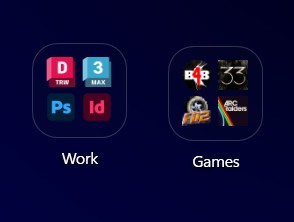
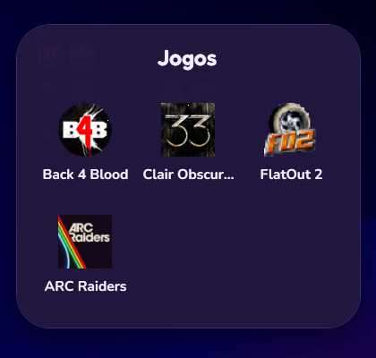
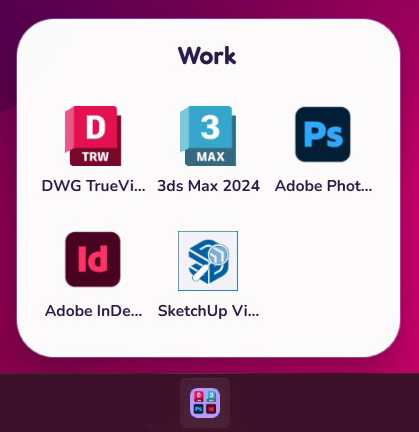
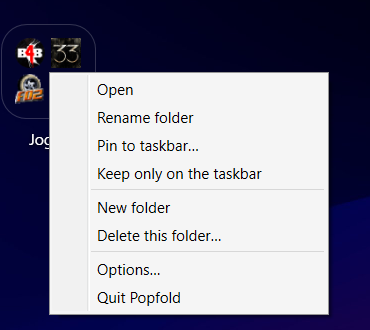
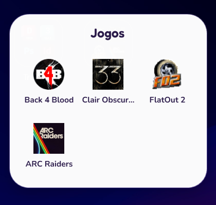
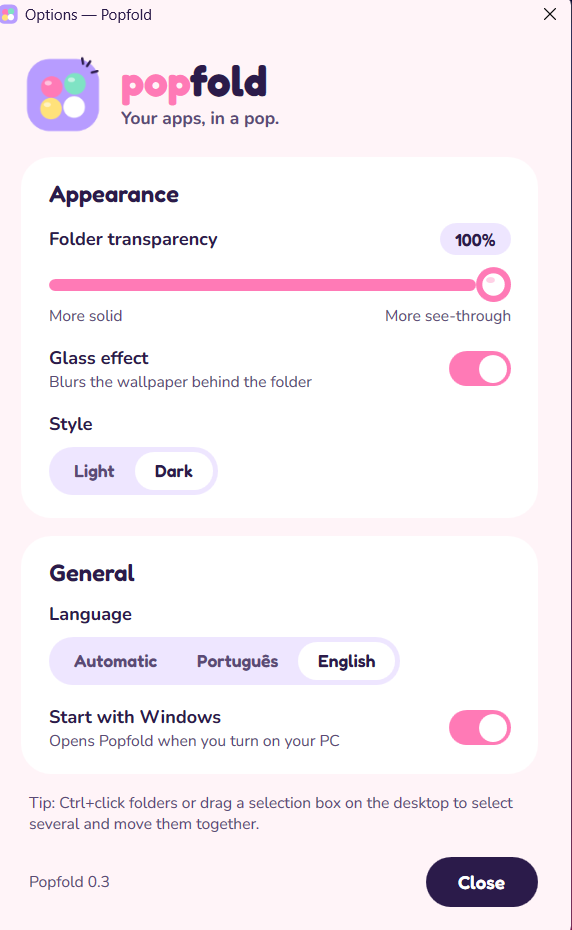

<p align="center">
  
</p>

<h1 align="center">Popfold</h1>

<p align="center"><b>Your apps, in a pop.</b><br>
Android/iOS-style folders for the Windows desktop and taskbar.</p>

<p align="center">
  <a href="../../releases/latest"><b>⬇ Download for Windows</b></a> ·
  <a href="README.pt-BR.md">Leia em português</a>
</p>

<p align="center">
  
  &nbsp;
  
</p>

---

Popfold groups programs, shortcuts, websites, files and folders into little folders that live on your desktop.
Click one and a compact panel pops open with its apps. Click an app and it launches. No File Explorer
windows, no clutter.

## Features

- **Folders on the desktop**: each Popfold shows a 2×2 preview of its apps. Click to open, click outside or
  press <kbd>Esc</kbd> to close.
- **Drag and drop to add**: drop programs, shortcuts, files, folders or links from your browser onto a folder.
  Shortcuts are copied into Popfold, so you can delete the originals from your desktop.
- **Drag to organize**: drag apps inside an open folder to reorder them, or drop one onto another folder to move it.
- **Pin to the taskbar**: pin any Popfold next to your other apps. Click it to open the panel right above the
  taskbar, or right-click it for a quick list of its apps. You can even keep a folder *only* on the taskbar.
- **New > Popfold**: create a folder right where you right-click on the desktop.
- **Move and select like icons**: drag folders around, <kbd>Ctrl</kbd>+click or drag a box to select several,
  and press <kbd>Delete</kbd> to remove them.
- **Stays put**: folders remain visible with <kbd>Win</kbd>+<kbd>D</kbd> (Show desktop).
- **Looks the part**: frosted-glass folders that blend with your wallpaper, adjustable transparency,
  light and dark styles.
- **English and Portuguese**, picked automatically from your Windows language.
- **Update notices**: a tray notice when a new version is out.

<p align="center">
  
  &nbsp;
  
  &nbsp;
  
  &nbsp;
  
</p>

## Install

1. Download **Popfold-Setup-x.y.z.exe** from the [latest release](../../releases/latest).
2. Run it. Popfold isn't digitally signed yet, so Windows may show *"Windows protected your PC"*:
   click **More info** → **Run anyway**.
3. Popfold opens with a few sample folders. Right-click any folder for options.

Requires Windows 10 (1809) or Windows 11, 64-bit. Everything Popfold needs is included in the installer.
The **New > Popfold** option in the desktop right-click menu appears after you restart your computer once.

To uninstall, use *Settings › Apps*. You'll be asked whether to keep your folders in case you reinstall.

## Tips

| To… | Do this |
| --- | --- |
| Rename a folder | Click its name inside the open panel |
| Run an app as administrator, open its location, rename or remove it | Right-click it inside the panel |
| Pin a folder to the taskbar | Right-click the folder → *Pin to taskbar…*, then right-click the shortcut that appears → *Show more options* → *Pin to taskbar* |
| Keep a folder only on the taskbar | Right-click the folder → *Keep only on the taskbar*. Bring it back from the tray icon → *Show on desktop* |
| Reorder apps | Drag them inside the open panel |
| Move an app to another folder | Drag it out of the open panel onto the other folder |
| Change transparency, glass, style, language, startup or update notices | Right-click a folder → *Options…* (or double-click the tray icon) |
| Update Popfold | Tray icon → *Check for updates*, then install the new version over the old one |

Your folders are stored in `%AppData%\Popfold`.

**Privacy:** the only thing Popfold looks up online on its own is the public list of Popfold releases on GitHub,
once a day, to tell you about new versions. No data about you or your folders is sent. Turn it off in *Options*.
(Website shortcuts also fetch their icon from that website.)

## Building from source

Requires the [.NET 10 SDK](https://dotnet.microsoft.com/download) on Windows.

```powershell
dotnet build -c Release
.\bin\Release\net10.0-windows\Popfold.exe
```

To build the installer you also need [Inno Setup 6](https://jrsoftware.org/isinfo.php):

```powershell
.\tools\build-installer.ps1   # → dist\Popfold-Setup-<version>.exe
```

Run Popfold from File Explorer, the Start menu or a regular terminal. If it is launched from inside a packaged
(sandboxed) app, Windows would redirect its data to that app's private storage, so Popfold refuses to start
there.

<details>
<summary>Project layout</summary>

| Path | What it is |
| --- | --- |
| `FolderWindow.*` | A folder on the desktop (glass box, 2×2 preview, drag, drop) |
| `PanelWindow.*` | The pop-up panel with the folder's apps |
| `SettingsWindow.*`, `Theme.xaml` | Options window and the "Bubble Gum" theme |
| `TaskbarPins.cs`, `ShellLink.cs` | Taskbar shortcuts, icons and jump lists |
| `ShellIntegration.cs`, `DesktopWatcher.cs` | *New > Popfold* in the desktop menu |
| `DesktopSelection.cs` | Box selection and the Delete key on the desktop |
| `L.cs` | English and Portuguese strings |
| `installer/` | Inno Setup script |
| `tools/` | Icon, installer art and installer build scripts |
| `branding/` | Icons, installer art and their sources |

</details>

## License

[MIT](LICENSE). Fonts: [Fredoka](https://github.com/hafontia/Fredoka-One) and [Nunito](https://github.com/googlefonts/nunito),
under the SIL Open Font License (see `fonts/`).
